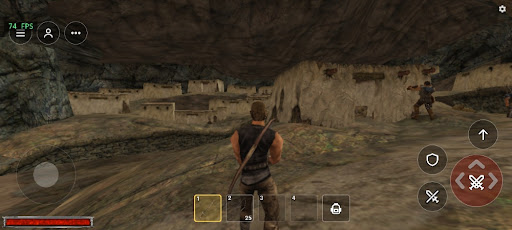
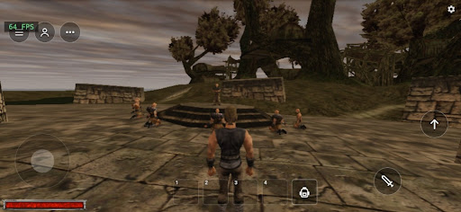

# GothicDroid

**GothicDroid** is a port of [OpenGothic](https://github.com/Try/OpenGothic), the open source re-implementation of the
Gothic and Gothic II: Night of the Raven engine, to phones and browsers.

- **Native Android build**: the game runs natively on Android with touch controls.
  **Play on Android: [download the APK from Releases](https://github.com/slaker222/gothicdroid/releases)**
- **Web version for Android, iPhone and PC**: play in the browser (WebGPU), nothing to install:
  **https://gothicplay.fun**

*Gothic on a phone with a Snapdragon 695 (touch controls, FPS counter in the top left corner).*

*Gothic on a phone with a MediaTek Helio G90T.*

## Links

- Web version: https://gothicplay.fun
- Upstream engine: https://github.com/Try/OpenGothic

## Credits and legal

Unofficial fan project. Gothic and Gothic II, including all game assets, characters, names, music and trademarks,
belong to Piranha Bytes and their respective rights holders. The project does not contain any game assets and is not
affiliated with or endorsed by the rights holders.

Based on [OpenGothic](https://github.com/Try/OpenGothic) and the Tempest engine by Try, MIT License.
